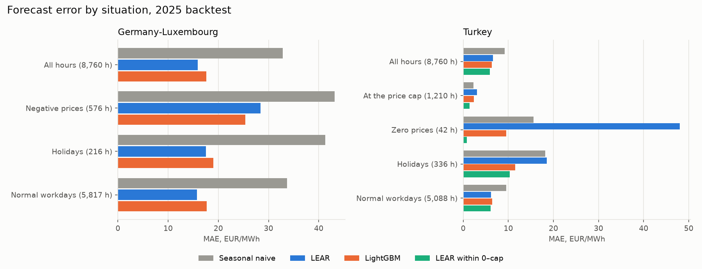
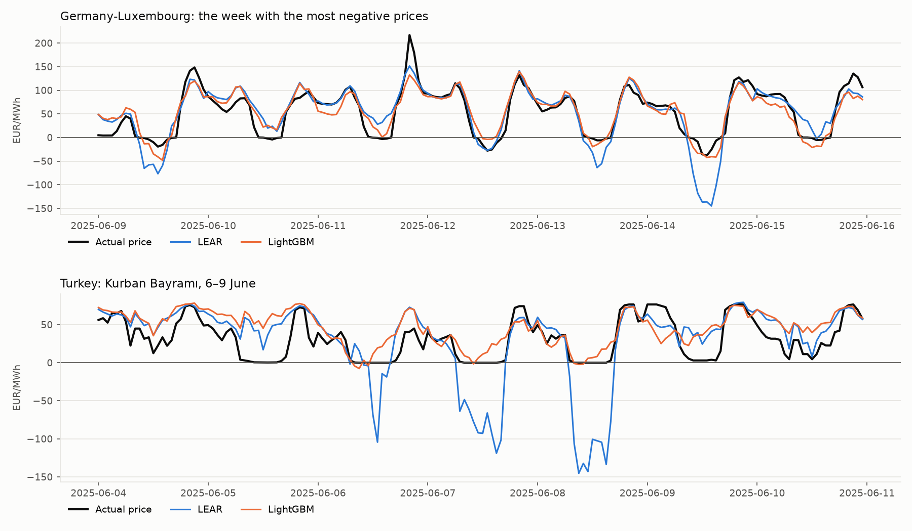
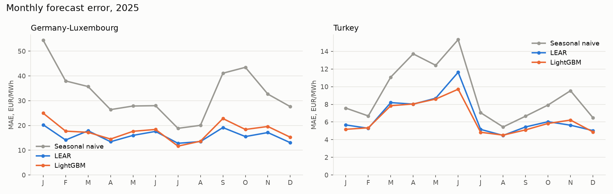
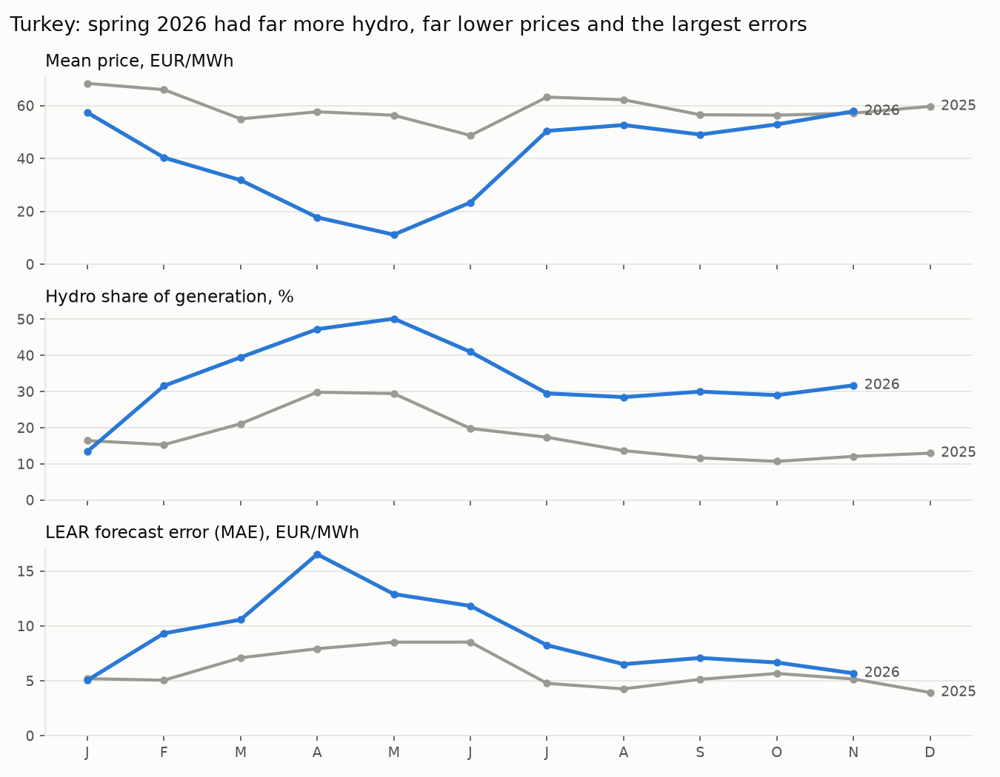

# Energy Price Forecast

Day-ahead electricity price forecasting for Germany-Luxembourg and Turkey: the same pipeline and
models applied to two very different markets.

## First results: 2025, both markets

Rolling-origin backtest over every delivery day of 2025 (8,760 hours per market). Each forecast is
issued at 11:00 local time on the day before delivery, using only prices published by then and
weather *forecasts* (Open-Meteo historical forecasts, not observed weather). Models are refitted
weekly on an expanding window starting in January 2023. Turkish prices are compared in EUR.

| Model | DE-LU MAE | DE-LU rMAE | Turkey MAE | Turkey rMAE |
|---|---:|---:|---:|---:|
| Seasonal naive (same hour last week) | 32.8 | 1.00 | 9.2 | 1.00 |
| Naive (same hour on the issue day) | 26.0 | 0.79 | 9.0 | 0.98 |
| LightGBM | 17.6 | 0.54 | **6.3** | **0.69** |
| LEAR (LASSO on asinh-transformed prices) | **15.9** | **0.48** | 6.6 | 0.72 |

MAE in EUR/MWh; rMAE is the MAE relative to the seasonal naive on the same hours.

- **Germany is harder in absolute terms but more predictable from weather.** Errors are about
  2.5 times larger, yet the models halve the naive error: with this much wind and solar, a weather
  forecast explains a large part of tomorrow's price.
- **Turkey is calmer but gains less.** The price cap (3,400 TRY/MWh in 2025) and a gas- and
  hydro-driven supply make yesterday's price almost as good as last week's (rMAE 0.98), and the
  models improve on it by about 30%.
- **The best model differs, until the market's rules are applied.** The linear LEAR wins in
  Germany, as in the forecasting literature (Lago et al., 2021). In Turkey LightGBM wins at
  first, and the error analysis below shows why.

## Why: where the forecasts go wrong



**Turkey: the linear model ignores the market's bounds.** Turkish prices can be neither negative
nor above a regulated cap, which the market hit in 1,218 hours of 2025 (14%). On public holidays
demand collapses and prices sit at zero for hours; LEAR, a linear model on asinh-transformed
prices, extrapolates far below zero there (89 negative forecasts, down to −145 EUR/MWh during
Kurban Bayramı) and above the cap in 1,030 hours. LightGBM cannot predict outside the range it was
trained on, so it is naturally bounded, which is its whole advantage:

| Turkey, 2025 | MAE (EUR/MWh) |
|---|---:|
| LEAR | 6.61 |
| LightGBM | 6.34 |
| LEAR, never below zero (a fixed market rule) | 6.23 |
| **LEAR, bounded: within zero and the cap** (`lear_bounded`) | **5.94** |

In 2025, keeping LEAR within the market's bounds makes it the best model in every situation: its
error on zero-price hours falls from 48.0 to 0.8 EUR/MWh. The bounds live in
[`bounds.py`](src/price_forecast/bounds.py) and any model can use them (`make_model("<name>_bounded")`).
The cap is converted to EUR with the issue day's exchange rate, so nothing unknown at forecast
time is used. The cap schedule is in `config.py`: 4,200 TRY in January 2023, cut to 2,600 by
April 2023, then 2,700, 3,000, 3,400 from April 2025 and 4,500 from April 2026. Where the
regulator's (EPDK) decision could not be found, the date is the first day the market cleared at
the new cap.



**Germany: negative prices are the hard part.** Prices fell below zero in 576 hours of 2025, on
sunny, windy days with low demand. LEAR exaggerates these dips (down to −145 EUR/MWh when the
price was −40), and these hours are the only situation where LightGBM is better (25.4 vs 28.4
EUR/MWh). On ordinary hours, holidays included, LEAR stays ahead.



The seasonal naive is worst in winter and in September–October in Germany, when wind makes prices
swing from week to week; the models stay much flatter. The switch to 15-minute day-ahead products on
1 October 2025 left no visible mark on the hourly forecasts. Full tables:
[docs/analysis/results.md](docs/analysis/results.md).

**Takeaway.** Knowing the market's rules beat changing the model: a two-line bound on the linear
model's output did more than switching to gradient boosting.

## Does it hold on 2026?

The model was chosen on 2025, so 2026 (1 January to 4 November) is a real out-of-sample test. All
forecasts are kept within the price limits.

| Period | Mean price | MAE | MAE / mean price | rMAE |
|---|---:|---:|---:|---:|
| Germany-Luxembourg 2025 | 89.3 | 15.9 | 17.8% | 0.48 |
| Germany-Luxembourg 2026 | 115.8 | 22.2 | 19.2% | 0.51 |
| Turkey 2025 | 58.9 | 5.9 | 10.1% | 0.65 |
| Turkey 2026 | 39.0 | 9.4 | 24.1% | 0.77 |

**Germany holds; Turkey gets much harder.** In 2026 LightGBM also edges ahead of LEAR in Turkey
(9.04 vs 9.40 EUR/MWh), so "LEAR is best" is a 2025 result there, while LEAR still wins clearly in
Germany (22.2 vs 25.5).



The error peaks in spring 2026, when hydro generation reached 47–50% of the total against about
30% a year earlier, the mean price fell to 11–18 EUR/MWh and up to 29% of the hours in a month
cleared at zero. These move together; the data does not prove the cause. The model had never seen
such a period.

**More data did not fix it.** I added the system operator's load plan and the realised generation
mix (by source, from the last complete day) to the Turkish model and tested both years:

| Model | MAE 2025 | MAE 2026 |
|---|---:|---:|
| LEAR | 5.94 | 9.40 |
| LEAR + load plan | 5.87 | 9.57 |
| LEAR + generation mix | 5.94 | 9.14 |
| LEAR + both | 5.88 | 9.19 |

The load plan helps a little in 2025 and hurts in 2026; the mix does nothing in 2025 and gains
about 3% in 2026, mostly in April and May. The hydro share correlates strongly with the price
(−0.49), yet adds little, probably because yesterday's prices already carry that information.
Neither was added: the gain is not consistent, and the load plan could not be shown to be published
by the 11:00 issue time. A shorter training window was no answer on its own: 180 days improves
spring 2026 in Turkey (16.5 to 11.6 EUR/MWh in April) but costs Germany over the year (22.2 to 24–26,
depending on the day the weekly refits start). Full tables:
[docs/analysis/turkey_2026.md](docs/analysis/turkey_2026.md).

## Combining the models

Different models fail at different times, so the next test was to combine them without any new
data. The rule was fixed before the results: a method replaces LEAR only if it is better in all
four market-years, reliably (paired t above 2 on daily errors).

| MAE, EUR/MWh | Germany 2025 | Germany 2026 | Turkey 2025 | Turkey 2026 | Rule |
|---|---:|---:|---:|---:|---|
| LEAR (bounded) | 15.92 | 22.19 | 5.93 | 9.39 | |
| **Median of three** | **15.51** | **21.56** | **5.69** | **8.42** | **passes** |
| Mean of three | 15.53 | 21.94 | 5.63 | 8.39 | fails |
| Median of three + 7-day error correction | 15.72 | 20.90 | 5.72 | 7.96 | fails |

The three are LEAR on all history, LEAR on the last 180 days and LightGBM; every hour the median
discards the outlier. It is the pipeline's default (`median_bounded`). With the live job's shorter
history, training from January 2025, it also wins in 2026: 21.50 vs 22.30 in Germany (t = 4.6) and
8.52 vs 9.23 in Turkey (t = 6.0).

Two limits. 2026 had already been looked at, so this is not fully independent; the live job keeps
running bounded LEAR beside the median, which is the real test. And the median does not solve
Germany's recent under-forecast: since 28 October it is still about 62 EUR/MWh too low on average
(LEAR: 67). The error correction narrows that to 44 and gives the best 2026 results, but it fails
the rule on Germany 2025 (t = 1.3), so it was left out. Full table:
[docs/analysis/ensemble.md](docs/analysis/ensemble.md).

## What is the forecast worth?

MAE does not say what a forecast is good for, so I scheduled a battery from each forecast and paid
it at realised prices: 1 MW / 2 MWh, 85% round trip, one cycle a day, empty at the start and end of
each day ([`battery.py`](src/price_forecast/battery.py)). The ceiling is the same battery with the
prices known in advance.

| EUR per MW per day (share of the ceiling) | Germany 2025 | Germany 2026 | Turkey 2025 | Turkey 2026 |
|---|---:|---:|---:|---:|
| Prices known in advance | 198 | 259 | 62 | 87 |
| **Median of three** | **184 (93%)** | **247 (95%)** | **55 (89%)** | **79 (91%)** |
| LEAR (bounded) | 186 (94%) | 248 (96%) | 55 (89%) | 78 (90%) |
| Hourly profile, last 28 days | 180 (91%) | 244 (94%) | 52 (84%) | 76 (87%) |
| Issue day's prices | 172 (87%) | 235 (91%) | 48 (77%) | 71 (81%) |
| Same day last week | 166 (84%) | 230 (89%) | 48 (78%) | 72 (83%) |

**Most of the money needs no model.** The rule, fixed before the results, was that the median must
beat each simple benchmark in all four market-years (paired t above 2 on daily profit). It beats them
in 11 of 12 comparisons but fails on Germany 2026 against the 28-day hourly profile (t = 1.98). The
gain over that profile is about 3–4 EUR per MW per day, roughly 1,100–1,600 EUR a year. A battery
needs the shape of the day more than the level: in Germany in 2025 the median's error is 43% below
the profile's (15.5 vs 27.1), and its profit only 2.5% above.

**A lower error is not always more money.** In Germany the median has the lower error, but LEAR
earns slightly more; the gap is not reliable (t = −1.8 and −1.3). In Turkey in 2026 the median is
ahead (t = 2.2). In Germany's 8 days of under-forecasting since 28 October, the median earned 104 of
the 154 EUR per MW per day available, against 126 for LEAR and 112 for the profile. That is too few
days to conclude anything, but a wrong level did not leave the money untouched.

These are not expected earnings: the battery does not move prices and pays no fees or wear. Germany
has traded in 15-minute products since 1 October 2025, and hourly averages hide part of that spread.
Both years also helped choose the model, so this is not an independent test. Full tables:
[docs/analysis/battery.md](docs/analysis/battery.md).

## Live forecasts

[](https://takaindidenize.github.io/energy-price-forecast/)

**[Open the live dashboard](https://takaindidenize.github.io/energy-price-forecast/)**: the chart
above is regenerated every day (GitHub caches README images for a few hours).

Every day a GitHub Actions job ([`daily-pipeline.yml`](.github/workflows/daily-pipeline.yml))
ingests the newest prices and weather forecasts, forecasts the next delivery day for both markets
with `median_bounded`, scores the forecasts whose prices have since been published, and publishes a
static dashboard ([`report.py`](src/price_forecast/report.py)) to GitHub Pages. No server and no
paid cloud: data is carried between runs in the Actions cache, and an empty cache triggers a full
re-ingest. The live forecasts cannot be made again, so each run also merges them into CSV files on
the [`data` branch](https://github.com/takaindidenize/energy-price-forecast/tree/data/history)
([`history.py`](src/price_forecast/history.py)), and a run with an empty cache restores them from
there. GitHub disables schedules after 60 quiet days, so
[`keepalive.yml`](.github/workflows/keepalive.yml) commits a small counter once the latest commit is
50 days old.

The first live forecasts, issued on 3 November 2026 for 4 November: Turkey's average forecast was
59.2 EUR/MWh against a realised 59.3, with an hourly MAE of 4.0 (seasonal naive 5.1). Over the
preceding two weeks the bounded model's MAE was 50.3 EUR/MWh in Germany (seasonal naive 118.2)
and 6.1 in Turkey (naive 10.8). German prices jumped to about 250 EUR/MWh from 28 October and the
model has been forecasting about 50 below since: the dashboard shows it, and it is the next thing
to investigate.

Three lessons from going live:

- **Schedules are not punctual.** GitHub started the first scheduled run 8 hours late, after the
  next day's prices were out, so the dashboard had no forecast still waiting for its result. Five
  morning slots did not solve it: on 6 and 7 November 2026 the job still started around 10:20–11:00
  UTC, after Turkey's auction closed. The slots now start at 00:17 UTC, which is untested, and the
  dashboard states each day whether the forecast was ready before the auction closed. A check on
  real data confirmed a late run gets the same forecast with or without the published prices.
- **Regulated limits change.** EPDK raised the Turkish cap from 3,400 to 4,500 TRY on 4 April
  2026, so a forecaster built on 2025 data clipped every higher price. The monitor now warns when
  realised prices break the configured limits.
- **Tomorrow's weather has to be asked for differently.** Open-Meteo's historical forecast API
  serves the latest forecast for the coming days too, but rejects end dates more than about 15
  days ahead, so the current month is fetched only up to a week ahead.

## Run it

```bash
python -m venv .venv
source .venv/bin/activate            # Windows: .venv\Scripts\activate
pip install -e ".[dev]"

python -m price_forecast.ingestion.energy_charts --start 2023-01 --end 2025-12
python -m price_forecast.ingestion.weather --market de_lu --start 2023-01 --end 2025-12
python -m price_forecast.pipeline --market de_lu --date 2025-12-30 --models seasonal_naive,median_bounded
python -m price_forecast.monitor --market de_lu      # joins forecasts with realised prices
python -m price_forecast.report --out site           # site/index.html, the dashboard
uvicorn price_forecast.api:app                       # http://localhost:8000/docs
```

`python -m price_forecast.pipeline --days 14` backfills the last two weeks of forecasts, so a new
dashboard has history to show.

Turkish prices need an account on the EPİAŞ Transparency Platform; set `EPIAS_USERNAME` and
`EPIAS_PASSWORD` in the environment, then `python -m price_forecast.ingestion.epias`.

Reproduce the analysis (after ingesting both markets for 2023–2025):

```bash
pip install -e ".[analysis]"
python analysis/run_backtests.py      # a few minutes; writes data/backtest_<market>_2025.parquet
python analysis/error_analysis.py     # writes docs/analysis/results.md and docs/img/*.png
python analysis/turkey_2026.py        # about ten minutes; needs data to 4 November 2026
python analysis/ensemble.py           # about ten minutes; needs data to 4 November 2026
python analysis/battery.py            # about fifteen minutes; needs data to 4 November 2026
```

These backtests train on data from January 2023. The live job trains from January 2025, to keep
its first download short.

## Data sources

- Day-ahead prices for DE-LU: [Energy-Charts](https://energy-charts.info) (Fraunhofer ISE), data
  from Bundesnetzagentur | SMARD.de, CC BY 4.0.
- Turkish market clearing prices: [EPİAŞ Transparency Platform](https://seffaflik.epias.com.tr).
- Weather: [Open-Meteo](https://open-meteo.com) historical forecast API.
